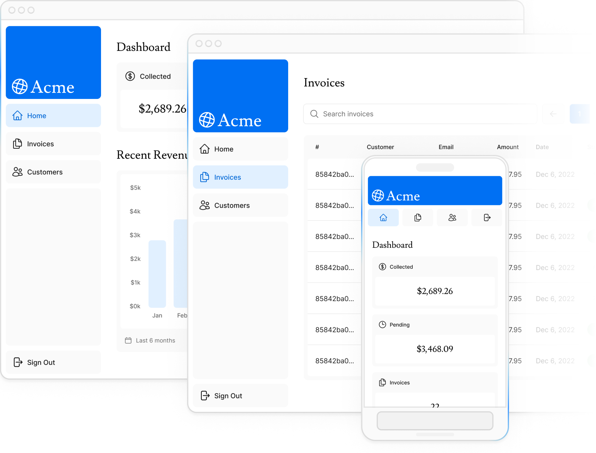

# Acme Dashboard

A full-stack invoicing dashboard built with the Next.js App Router, React Server Components and Postgres.

**Live demo:** nextjs-dashboard-sable-nine-62.vercel.app



## Why this project exists

I built this app while completing Vercel's official
[Next.js App Router Fundamentals](https://nextjs.org/learn/dashboard-app) course.
The goal was to learn the modern Next.js stack hands-on, beyond reading the docs:
server-side data fetching, mutations without a separate API, streaming, auth and
deployment, all in one real app instead of isolated snippets.

The result is a small admin panel for a fictional company, Acme. You can log in,
see revenue and invoice stats, and search, create, edit and delete invoices.

## Demo login

| Email | Password |
|---|---|
| `user@nextmail.com` | `123456` |

This is a public demo account from the course seed data, not a real user.

## Features

- **Dashboard overview:** summary cards, a revenue chart and the latest invoices, loaded from Postgres in parallel.
- **Streaming and loading states:** React Suspense and skeletons, so slow queries don't block the whole page.
- **Invoices:** a table with search and pagination. Search state lives in the URL, and input is debounced.
- **Create, edit and delete:** Server Actions with Zod validation and per-field error messages via `useActionState`.
- **Error handling:** `error.tsx` and `not-found.tsx` boundaries.
- **Authentication:** NextAuth.js (Auth.js) with credentials and bcrypt-hashed passwords. Dashboard routes are protected.
- **Styling:** Tailwind CSS, responsive layout, and fonts and images optimized with `next/font` and `next/image`.

The Customers page is still a placeholder.

## Tech stack

- [Next.js 16](https://nextjs.org/) (App Router, Server Components, Server Actions)
- [React 19](https://react.dev/)
- [TypeScript](https://www.typescriptlang.org/)
- [PostgreSQL](https://www.postgresql.org/) via [`postgres`](https://github.com/porsager/postgres) (hosted on Prisma Postgres)
- [NextAuth.js v5](https://authjs.dev/)
- [Zod](https://zod.dev/)
- [Tailwind CSS](https://tailwindcss.com/)
- Deployed on [Vercel](https://vercel.com/)

## Running locally

Requirements: Node.js 20+ and [pnpm](https://pnpm.io/).

1. Install dependencies:

   ```bash
   pnpm install
   ```

2. Create a `.env` file in the project root:

   ```bash
   POSTGRES_URL=postgres://...
   AUTH_SECRET=   # generate with: openssl rand -base64 32
   AUTH_URL=http://localhost:3000/api/auth
   ```

3. Start the dev server:

   ```bash
   pnpm dev
   ```

4. Seed the database once by opening http://localhost:3000/seed. This creates the tables and the demo user.

5. Open http://localhost:3000 and log in with the demo credentials above.

## Scripts

| Command | What it does |
|---|---|
| `pnpm dev` | Start the dev server with Turbopack |
| `pnpm build` | Production build with type checking |
| `pnpm start` | Run the production build |
| `pnpm lint` | Run ESLint |
